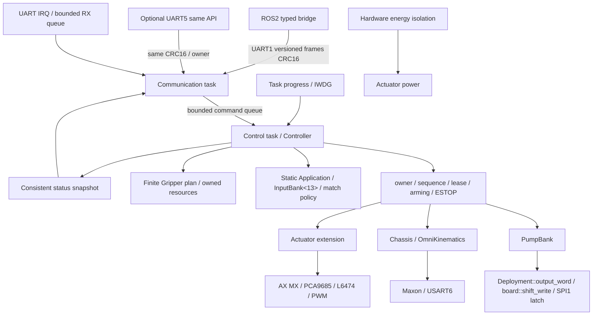

# Архитектура EUROBOT NEXT

Текущая реализация включает конечные планы 2026, профили шаговиков, Application, match и input policy, typed maintenance и два UART входа с единой authority. Фактические результаты полной текущей сборки и тестов, ELF/MAP и аппаратные ограничения собраны в [VALIDATION_REPORT.md](VALIDATION_REPORT.md); HIL/WCET не измерены.

Основной принцип: одна управляющая задача владеет прикладным состоянием исполнительных механизмов. UART IRQ передают только байты через bounded rings; ROS не вызывает embedded драйверы напрямую. Выделенный TIM1 service IRQ продвигает stepper planner и выдаёт pulse; обращения Control к этому shared planner защищены StepGuard, исключающим одновременное изменение. Объекты создаются статически; в собственном embedded-коде нет heap, exceptions, RTTI и оператора `continue`.

## Уровни

`core.hpp/core.cpp` — переносимая логика: PumpBank, геометрии 2025/2026, Chassis, Pid, Controller, wire FrameParser/Dispatcher. Аппаратный доступ передаётся через узкие callback contracts с Error; успешный callback означает принятую передачу, а не физический результат.

Драйверы устройств кодируют фактические протоколы и проверяют длины/диапазоны: Dynamixel protocol1, Maxon/BMS registers, PCA9685, L6474, PWM/HBridge и LED. Они отделены от register access STM32 и тестируются с подставным транспортом. Такой транспорт используется только host тестами; целевая прошивка обязана связывать драйвер с конкретным периферийным модулем.

Плата STM32 отвечает за clocks, GPIO, SPI/UART/I2C, timer/IRQ, DMA, watchdog и статические RTOS ресурсы. Именно здесь проверяются реальные профили, доступность каналов, reserved bits, безопасный старт и полные deadlines. Сторонние CMSIS/FreeRTOS не переписываются ради C++.

ROS 2 работает на host с POSIX UART. Bridge использует то же ядро wire protocol, а не второй независимый encoder. Типизированные cmd_vel, output/actuator/maintenance services, Gripper action, state и diagnostics задокументированы в ROS2_INTERFACES.md. ROS не имеет прямого альтернативного доступа к SPI или Maxon.

## Задачи и время

Проект использует FreeRTOS со статическими ресурсами:

| Задача | Приоритет | Период | Stack words / байт |
|---|---:|---:|---:|
| Control |4|10 мс|2048 /8192|
| Comms |3|1 мс|1024 /4096|
| Watchdog |2|20 мс|256 /1024|
| Idle |0|по готовности|256 /1024|

Control единолично владеет Controller и драйверами. Две очереди commands/replies имеют по 8 элементов Packet{Frame,port,reset_after_reply}. UART1 RX ISR использует кольцо 1024B; optional UART5 — отдельное кольцо 256B и второй FrameParser. Port tag возвращает ACK в тот же UART, однако Controller, sequence/lease gate и очередь исполнения общие. Comms декодирует/кодирует wire и обменивается Packet через очереди. UART5 включается только Deployment.debug_uart_enabled=true, по умолчанию false; он также работает 115200 baud и не предоставляет небезопасный legacy command parser. UART1 новой системы работает 115200baud; legacy 921600 не сохранён. TIM2 даёт монотонный такт 1 МГц. Watchdog обновляет IWDG только если обе задачи Control и Comms продвигаются с давностью меньше 100 мс. Отдельный TIM1 update IRQ обслуживает stepper planner каждые 100 мкс; shared planner операции управляющей задачи защищаются guard этого IRQ. Верхний программный предел 10000 шагов/с, фактическая скорость квантована периодом обслуживания. Профили разгона/торможения2026 реализованы bounded division table в StepperPlanner; timebase не подменяется предположением 50 мкс. ISR при фактическом PSC167/ARR99 выполняется 100 мкс, fractional base ticks учитываются явно; перепрыгивание нескольких pulse edges запрещено. TIM8 CH3/PC8 с DMA2 Stream1 Channel7 передаёт LED GRB и 500 мкс reset, с ограниченным ожиданием окончания. Стеки проверяются через high-water marks на стенде; WCET ещё не измерен.

Критические особенности: control tick обязан исполняться регулярно; ни FIFO, ни mutex, ни UART status, ни I2C flag не должны ждать бесконечно. Номинальный период10мс включает вычисления и обслуживание операций, но измеренный WCET пока отсутствует; если последовательные запросы к трём приводам превышают бюджет, их нужно распределить по итерациям или использовать неблокирующую транзакцию. Watchdog обновляется после проверки продвижения критических задач, а не из ISR или безусловного loop.

DMA-буферы размещаются в обычной SRAM0x20000000, CCM0x10000000 не используется для DMA. Профиль MCU — F407VG,1 МиБ Flash,128 КиБ SRAM и 64 КиБ CCM по legacy Keil. Переполнение stack/очередей, число отброшенных пакетов и transport failures должны попадать в diagnostics.

## Безопасность и состояние

Порядок: safe initialization → claim с новым nonce владельца → explicit rearm → свежие команды. Heartbeat продлевает только lease; он не продлевает срок последней команды насосов/скорости. Повтор sequence и чужой owner отвергаются; ESTOP принимается независимо от владельца. После timeout/fault armed снимается, старые команды не восстанавливаются.

Requested — принятая заявка; commanded/known — результат последней передачи драйверу; measured/known — реально измеренное состояние. Без датчика давления/тока насос имеет measured_known=0. Аналогично выданные stepper pulses не являются физической позицией при пропуске шагов. ACK от ROS отражает controller result, а не успех механического действия.

Boot не включает насосы, torque сервоприводов или автоматический homing. Deployment требует 8..32 логических насосов. В default reference назначены только первые 4 pump/valve routes, остальные остаются unassigned, поэтому такой профиль не проходит commissioning. Программная поддержка 8/16/32 не означает, что физически проложены все дополнительные каналы; непривязанные каналы и неизвестные физические пределы блокируются. Без подтверждённого hardware profile выпускать вооружённую конфигурацию нельзя.

GPIO-фильтр DebouncedInput/InputBank<13> находится в inputs.hpp. Runtime статически создаёт Application, sample_inputs получает 13 входов, tick исполняется в Control 10 мс. Game/debug, cord, strategy, side, motor request, девять switches, очередь 64 callback events и match timeout99000мс работают через существующую authority/stop callbacks. Raw sensors wire и filtered Application snapshot/event доступны раздельно; INPUTS.md описывает polarity и inversion механических switches.

Обработчики критических fault вызывают board::fail_safe: локальные PWM/GPO отключаются по возможности, IRQ запрещаются. Это не гарантирует немедленную отправку нуля внешним UART-приводам. Необработанный vendor IRQ может остаться в Default_Handler до watchdog reset; до старта IWDG зависание boot не имеет такой гарантии. Поэтому критическая остановка энергии требует отдельной аппаратной цепи.

Драйверы дают примитивные транзакции; gripper::Engine реализует поверх них конечные cursor/side/lift/slide/rotation/pump/capture/release/prepare и motion recipes с deadline, cancel, job ID и evidence. Совместимые операции2025 названы явно и не являются default. Application не повторяет сценарий захвата в отдельном потоке.

## Выбор связи

Для этой версии выбран host ROS 2 bridge с bounded UART и CRC16. Это позволяет изолировать real-time safety от ROS executor и не требует запускать DDS на F407. micro-ROS не считается интегрированным: его memory/agent/transport затраты в этом проекте не измерялись. Здесь нет фиктивного слоя micro-ROS и конкурирующего интерфейса команд. Если он понадобится позже, транспорт должен вести в тот же Controller.

## Приложение сценариев финальной 2026

`gripper.hpp/gripper.cpp` задают bounded plan до 64 фаз. `runtime.cpp` — единственный владелец engine и физических драйверов; никаких sleep/delay циклов рецепта внутри Control. Каждая итерация issue/feedback продвигает конечное состояние с общим и фазовым deadline. Wire0x21/0x22/0x23 предоставляет submit/query/cancel и snapshot25; accepted отличается от completion. Во время job отвергаются только пересекающиеся primitive ресурсы. Pump/valve selections, DXL/PCA/stepper targets и chassis ownership проверяются по плану; независимые команды продолжаются. Одна Gripper очередь не означает глобальной блокировки всех приводов. Cancel останавливает физические выходы всей сессии; после него старая cached Twist не возобновляется. Completion evidence различает commanded, settled по времени, referenced steps и measured; PCA не объявляется измеренным положением.

Config factories — технические references2026, а не commissioned deployment: ID254 не назначен, pump/valve routes неизвестны, reviewed=false. Только полный reviewed профиль позволяет соответствующую операцию. Prepare запускается явно; startup torque/движение/homing не воспроизводится автоматически. 2025reset/cycle — отдельный fallback, не default. ROS workspace реально собран и протестирован в Jazzy/Lyrical Linux Docker; host harness проверяет переносимую логику. Итог актуальной полной ARM/host сборки фиксируется в VALIDATION_REPORT.md; статический бюджет RAM и измеренный WCET различаются, последний требует стенда.

## Сервисный reset и диагностика

Maintenance 0x24 обрабатывается тем же Dispatcher. Read-only запросы доступны без owner и не потребляют управляющий sequence; изменения требуют подходящего disarmed/armed/owned режима и единой lease. Это явные типизированные операции, не raw UART/register passthrough. Поддерживаются reset/cause/clear, wheel ticks/path/reset readback, servo/BMS/Maxon/PWM/PCA/L6474 service methods, application snapshot/event и bounded diagnostic text; полный контракт — ROS2_INTERFACES.md.

BOARD_RESET сначала вызывает application stop и помечает reset_pending. Control помещает успешный ACK в tagged reply Packet. Физический NVIC_SystemReset вызывается Comms только после успешного host_write/debug_write и ожидания UART TC; ошибка/timeout передачи не объявляется подтверждённым reset. UART5 использует ровно этот путь. Никакого физического reset или записи платы при host/Docker проверках не выполнялось.
