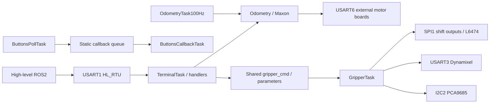

# Анализ прошивок 2025/2026

Анализ основан на исходниках, а не на ранее сгенерированных отчётах. Дата 19 октября 2026. Оригиналы прочитаны без изменения; этот документ не включает их текст. Наличие ST-баннеров не устанавливает права на всё приложение. Права на пользовательские legacy-файлы неизвестны; они исключаются из публикуемого нового репозитория до отдельного подтверждения.

## Источники и дубликаты

Основные наборы: `01_FIRMWARE_2025/SOURCE/Core` (39 файловC), `02_FIRMWARE_2026/SOURCE/Core` (45 файловC). Для каждого `.c` проверено совпадение байтов с соответствующим `PROJECT/.../Core`: различий нет. SOURCE2025 также совпадает с ORIGINAL_ARCHIVE; SOURCE2026 совпадает с успешно извлечённым `09_ANALYSIS/EXTRACTED_ARCHIVES/02b_firmware_2026_unrar/eurobot2026-stm/Core`. Папка `02_firmware_2026_rar` от неудачной попытки содержит нулевые файлы, её нельзя принимать за другую прошивку. `.ioc` главной платы не найден: обнаруженные `.ioc` относятся к примерам Keil pack.

Есть отдельный локально изменённый вариант `2025 г./eurobot_2025_main_board-master/Core/App/terminal_cmd_handlers.c`: он добавляет PumpOn/PumpOff. В реестр включены обе дополнительные функции. PumpOff ошибочно вызывает SET тех же OUTPUT1|OUTPUT2, что и PumpOn; команда выключения включает выходы. Это не тот же четырёхканальный gripper mapping2026, и назначение OUTPUT2 здесь не доказывает проводку текущего клапана. Остальные одинаковые определения не дублируются. Keil/startup/scatter, HAL/LL/CMSIS и FreeRTOS присутствуют в PROJECT/SOURCE. `legacy_source_manifest.csv` фиксирует SHA256 файлов Core и отличающегося локального файла; исходники не импортируются в новый проект.

`03_HIGH_LEVEL_2026/eurobot2026-main/modules` содержит communication (`stm_2022`,`stm_2023`), navigation/path planning/trajectory regulator/costmap, localization и localization_ekf, BT, onboard_cv, sima_communication и общий eurobot_interfaces. Docker communication использует закреплённый ROS-образ с комментарием Humble (`modules/communication/Dockerfile:1`); Compose запускает stm_2023, EKF, navigation и BT (`docker-compose.yaml:18`). `stm_2023_node.cpp:79` использует строковые command/response topics и отдельные TwistStamped для координат/скорости. Это исторический слой, а не основание сохранять string API в новой системе.

`04_COMPUTER_VISION` содержит ROS/Python башню, ArUco/pose/calibration/resource detection, tests и Docker. `06_TOOLS_AND_UTILITIES` включает панели/клавиатуру/управление присосками и ESP32/SIMA/OMNI. Эти приложения не являются библиотеками STM32; стратегия, CV, локализация и SIMA требуют отдельной миграции high-level. Физическое шасси контролируется главным STM32 через внешние Maxon-платы.

## Поток исполнения

Main настраивает clocks, GPIO, SPI/serial/timers, привязывает UART к протоколам и запускает FreeRTOS. В 2026 I2C2/PCA9685 и gripper/stepper initialization добавлены. Watchdog initializer существует, но вызов `IWDG_Init()` закомментирован (`02_FIRMWARE_2026/SOURCE/Core/App/main.c:121`), поэтому наличие функции не равно работающему watchdog.

## Задачи FreeRTOS

| Задача 2026 | Priority | Stack words (байт при 32 бит) | Цикл / обмен |
|---|---:|---:|---|
| ButtonsPoll |3|64(256)|1tick; debounce, static queue length=BUTTONS_NUMBER; send0wait |
| ButtonsCallback |2|64(256)|receive portMAX_DELAY; callbacks |
| Odometry |1|512(2048)|10ticks; чтение 3 внешних encoder totals |
| Terminal |1|512(2048)|GetRequest/dispatch; может ждать gripper completion |
| Game |1|512(2048)|50tick loop и blocking match sequence |
| Stepper |1|512(2048)|50tick polling, calibration via switches |
| Gripper |1|512(2048)|100+50tick idle cycle; shared command flags; delays/polls |
| Demo / DebugTerminal |не созданы|по 512|создание закомментировано в main |
| Template |не создана|512|шаблон без прикладной функции |

`02_FIRMWARE_2026/SOURCE/Core/App/main.c:125`; `02_FIRMWARE_2026/SOURCE/Core/OS_Tasks/odometry_task.c:38`; `02_FIRMWARE_2026/SOURCE/Core/OS_Tasks/buttons_poll_task.c:33`.

FreeRTOSConfig включает preemption,1000Hz tick, static allocation, dynamic allocation0,7 priorities; mutex разрешены, но явных mutex экземпляров в Core не найдено. Application software timers/semaphores/event groups не найдены несмотря на include. Queue используется кнопками; gripper completion — direct task notification. Файл `SOURCE/Middlewares/FreeRTOS-Kernel/include/FreeRTOSConfig.h:113` и далее. IRQ: steppers1, UART/timeouts3, LED DMA5, max syscall threshold11. Высокоприоритетным IRQ нельзя вызывать FreeRTOS API, требующие допустимый syscall priority; при миграции это проверяется отдельно.

## Цепочка насосов

1. HL_RTU принимает `FF FF length command data checksum` с инверсной суммой 8 бит (`02_FIRMWARE_2026/SOURCE/Core/Lib/hl_rtu.c:63`).
2. BOARD_TOGGLE_PUMPS=0x21 → `TogglePumps(data,length)`; data[0]=gripper_id, data[1]=mask, shared gripper_cmd=3 (`02_FIRMWARE_2026/SOURCE/Core/App/terminal_cmd_handlers.c:660`).
3. Terminal записывает свой task handle и ждёт notification5000ticks; результат ожидания игнорируется (`02_FIRMWARE_2026/SOURCE/Core/App/terminal_cmd_handlers.c:130`).
4. GripperTask case3 вызывает Gripper_SetPumps, затем notify. Функция включает ВСЕ 4, далее по одному выключает нулевые биты с задержкой 10ticks (`02_FIRMWARE_2026/SOURCE/Core/OS_Tasks/gripper_task.c:433`). Даже нулевая маска сначала кратко включает все насосы.
5. SPI_GPO изменяет software shadow24 и посылает 3 байта LSB-first на SPI1, затем STCP защёлкивает силовые выходы (`02_FIRMWARE_2026/SOURCE/Core/BSP/spi_gpo.c:34`). Подтверждённые насосы — выходы 1/3/5/7. Два gripper-профиля используют одинаковые 4 канала.
6. BOARD_TOGGLE_PUMP=0x0F в 2026 DebugTogglePump управляет только выходами 1/2, по `2*data[0]+data[1]` (`02_FIRMWARE_2026/SOURCE/Core/App/debug_terminal_cmd_handlers.c:215`). Это отдельный, неполный и конфликтующий путь; debug task в main выключен.

В каноническом 2025 pump-specific handlers нет: gripper task управляет двумя Dynamixel, а demo только переключает выбранные power outputs (`01_FIRMWARE_2025/SOURCE/Core/OS_Tasks/gripper_task.c:39`). Локальный вариант 2025 добавляет PumpOn/PumpOff для выходов 1/2, команды 0x0B/0x0C; обе функции выставляют биты и поэтому PumpOff не выключает нагрузку (`2025 г./eurobot_2025_main_board-master/Core/App/terminal_cmd_handlers.c:214`, `:227`). Сохранение имени старой команды не требуется: нужен единый масочный интерфейс и реальная таблица подключения.

## Драйверы и алгоритмы

DynamixelMaster реализует protocol1 FF FF ID LEN INSTR/PARAM CHECKSUM, ping/read/write/sync-write, FIFO, retry и receive timeout. Maxon/BMS используют тот же пакетный формат с собственными регистрами. `RegWriteCmd`, `ActionCmd`, `FactoryResetCmd`, `RebootCmd`, `BulkReadCmd` в старом драйвере пусты: они не считаются работающими возможностями только из-за имени. AX реализует ID, torque, angle, modes, speed, load и LED. MX angle/ID/torque/LED работают, но wheel/joint/speed bodies закомментированы, GetPresentLoad лишь возвращает0; название wrapper не доказывает чтение. AX GetMovingSpeed читает commanded register32, present speed — register38. Угловая шкала AX300° и MX360° различна.

L6474 получает параметры через общуюSPI1 с nCS между байтами; STEP формирует TIM1 interrupt с ramp/divider profile и software position. Position не является измеренным положением механизма; homing использует switches. PWM/RC servo и H-bridge разделяют TIM4/TIM5, частота общая на группу. PCA9685 добавляет 16 внешнихPWM, global address/calibration state. BMS предоставляет power/U/I/SOC/cells/calibration. WS2812B реализует RGB/DMA, а HSV body пуст. Кнопки имеют 8sample debounce и hold500ms.

Кинематика и одометрия подробно описаны в [CHASSIS.md](CHASSIS.md). Полный реестр определений, включая пустые и conditional branch routines: [FUNCTIONAL_COVERAGE.md](FUNCTIONAL_COVERAGE.md). Ошибки и ограничения: [KNOWN_ISSUES.md](KNOWN_ISSUES.md).

## Риски старой модели исполнения

Shared globals команд/аргументов не образуют атомарную заявку: повторная команда может заменить параметры или получить notification от другого задания; нет command ID/queue ownership. `vTaskSuspendAll()` не блокирует IRQ и не заменяет mutex шины. Обновление SPI_GPO_REG выполняется до scheduler suspension; read-modify-write может потерять concurrent update. UART wrappers ждут `is_data_ready` через yield без общего deadline; FIFO full тоже может ждать бесконечно. Считываниеpose и обновление нескольких float без snapshot синхронизации может возвращать смешанное состояние.

Ошибка SyncWrite критическая: цикл do/while с post-decrement выполняет лишнюю итерацию при count0, а response_array разыменовывается даже при NULL из gripper calls (`02_FIRMWARE_2026/SOURCE/Core/Lib/dynamixel_master.c:157`). Цепочка pump completion возвращает успех даже при timeout/COMM_ENABLE0. Payload handlers часто читают data[0..] без проверки длины. Включение GRIPPER_INIT вызывает движения и torque на старте. Эти механизмы переносить без исправления нельзя.

## Повторный аудит текущей C++ реализации

Прочитаны163 канонических reference-файла и один локальный вариант2025 и тела всех603 определений с привязкой к source+line. [CSV](legacy_functions.csv) теперь содержит для каждой функции source role, реальные синтаксические вызовы, SHA тела после удаления комментариев, аппаратный путь, конкретную новую реализацию, отличие, тесты и отдельное ограничение HIL. Препроцессорные варианты считаются отдельно; это не утверждение о составе старого ELF. Итоговые решения и ссылки — в [FUNCTIONAL_COVERAGE.md](FUNCTIONAL_COVERAGE.md).

Старые FIFO и callback слои заменены статическими FreeRTOS queues, ограниченными парсерами и сериализованным владельцем Control. Транспорт устройства имеет единый deadline, а USART1 и optionalUART5 разделяют один owner/sequence. LED DMA завершение/ошибки проверяются bounded polling в leds_write; отсутствие старого DMA IRQ имени не является потерей результата передачи. Любое электрическое временное свойство остаётся стендовой проверкой.

Application сохраняет13 inputs, init/state/click/hold events, strategy0…2, cord/side/motor flags,9 switches, GAME/DEBUG mode и99s остановку2026. Начальный held level не включает моторы. Рецепты gripper, конечное движение и обслуживание доступны типизированными запросами и проходят реальные guard/issue/feedback/stop callbacks. Параметры не передаются через общие неатомарные flags. Software acceptance, settled delay, referenced steps и measured feedback различаются в snapshot.

2025/2026 сравнивались по нормализованным телам. Полезных уникальных драйверных функций2025 сверх2026 не выявлено: MX/H-bridge/RC/BMS/PWM/L6474 совпадают;2026 AX добавляет getter скорости; stepper имеет тот же divider algorithm, но другую electrical initialization. Программа2025 demo действительно создаётся main и включает STEPPER_DEMO;2026 demo не создаётся, его макросы выключены. Бесконечный benchmark и фиктивная установка нуля не запускаются автоматически: сохранены явные ограниченные операции устройств.2025 PrepareRobot — только torque двух main AX, доступный явно;2026 PrepareRobot пуст.

Новый StepperPlanner использует реальный исходный base clock19200Hz, division cap32, V1_FACTOR0.78 и distance-limited ramp. Исправлены недопустимые нулевые стадии/underflow и пропуск последней ступени deceleration. Constant/profile homing ограничены timeout и travel; только physical switch задаёт reference. Старый поиск без deadline и непроверенный overtravel не выдаются за безопасно восстановленную калибровку.

Новые AX/MX и BMS методы проверяют length/CRC/device errors; независимые BMS чтения не требуют достоверности несвязанных полей. L6474 имеет таблицу разрешённых register widths/masks, корректные0x88 fixed STEP_MODE bits,31.25mA quantization и реальный NRST через mapped callback. ALARM_EN0x17 и motor1 TOFF_MIN0x10 восстанавливаются после reset согласно2026; для остальных TOFF_MIN сохраняет resetdefault. PWM/servo/DC timer groups проверяются на конфликт; LED buffer/profile поддерживает60pixels, PCA16каналов,4steppers,8PWM,3Maxon и13inputs не превращаются в произвольную физическую ёмкость.

Все аппаратные ограничения остаются отдельными: индивидуальный ID вместо254, дополнительные насосы/клапаны, питание, электрическая полярность, калибровка, пределы и удержание груза. Host/sanitizer, ARM link и ROS build подтверждают соответствующие программные слои; робот и программатор не использовались. Результаты конкретного среза — в VALIDATION_REPORT/TESTING, а не в предположениях по именам функций.
