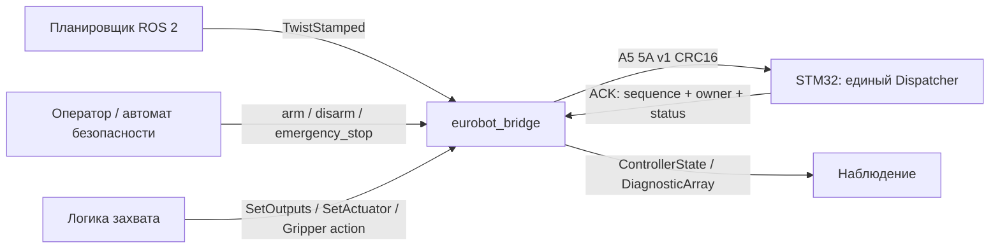

# Интерфейсы ROS 2

Единственный внешний интерфейс управления — `eurobot_hardware/eurobot_bridge` и новый бинарный протокол. Старый `/stm/command` со строками намеренно отсутствует. Шасси — трёхколёсная omni-платформа, поэтому поддерживается `linear.y`; дифференциальная кинематика не применяется. Кинематика и критическое управление остаются на STM32.

## Граф

Имена при штатном запуске:

| Имя | Тип | Назначение |
|---|---|---|
| `/eurobot/cmd_vel` | `geometry_msgs/msg/TwistStamped` | `linear.x/y` м/с, `angular.z` рад/с, система `base_link` |
| `/eurobot/state` | `eurobot_interfaces/msg/ControllerState` | Последний подтверждённый снимок STM32 и маски достоверности |
| `/eurobot/battery` | `sensor_msgs/msg/BatteryState` | Свежие измерения BMS; неизвестные величины NaN |
| `/eurobot/board_inputs` | `eurobot_interfaces/msg/BoardInputs` | GPIO уровни и маска достоверности, коды ошибок sensors/BMS |
| `/eurobot/diagnostics` | `diagnostic_msgs/msg/DiagnosticArray` | Доступность транспорта и состояние допуска к управлению |
| `/eurobot/arm` | `eurobot_interfaces/srv/Arm` | control_token=0 запрашивает новую сессию; accepted возвращает её token |
| `/eurobot/disarm` | `std_srvs/srv/Trigger` | Освобождение lease и безопасное отключение |
| `/eurobot/emergency_stop` | `std_srvs/srv/Trigger` | Защёлкнутый программный stop, допустим без владения |
| `/eurobot/set_outputs` | `eurobot_interfaces/srv/SetOutputs` | Атомарный запрос масок насосов и клапанов |
| `/eurobot/set_actuator` | `eurobot_interfaces/srv/SetActuator` | Типизированная команда периферии через тот же owner/armed gate |
| `/eurobot/maintenance` | `eurobot_interfaces/srv/Maintenance` | Типизированные board/peripheral query и явные сервисные операции |
| `/eurobot/gripper` | `eurobot_interfaces/action/Gripper` | Длительная операция 2026 с progress, cancel и уровнем доказанности завершения |

Параметры port/baud/timeouts/frame/current sign фиксируются при запуске и объявлены read-only; изменение требует контролируемого перезапуска bridge с новым явным arm. Для движения `header.stamp` обязателен, возраст при получении ≤200 мс, допуск на будущее 50 мс; часы источника и bridge должны быть согласованы. Неиспользуемые оси должны равняться нулю. NaN, infinity, выход за float32 и неверная система координат отклоняются. ROS QoS команд: best effort, volatile, depth 1; состояния: reliable, volatile, depth 1. Для сервиса действуют стандартные request/reply QoS. Старая команда движения не воспроизводится при переподключении.

Arm является типизированным сервисом: запрос `{control_token: 0}` приобретает новую сессию, только когда bridge disarmed. Успешный ответ содержит `accepted=true` и ненулевой `control_token`. Повторный запрос с тем же token идемпотентен; при активной сессии 0 или другой token отклоняется. SetOutputs, SetActuator и Gripper goal обязательно передают этот token; без совпадения активного token/owner и armed возвращается lease_conflict. Disarm и emergency_stop остаются доступными любому клиенту для безопасной остановки. После остановки, timeout, смены publisher или переподключения старый token больше не принимается; новая сессия требует Arm с 0.

Пример запросов после отдельного разрешения оператором: `/eurobot/arm` типа `eurobot_interfaces/srv/Arm` получает `{control_token: 0}`; только если accepted=true, клиент сохраняет token из ответа и посылает SetOutputs `{control_token: TOKEN, pumps_select: 0, pumps_values: 0, valves_select: 0, valves_values: 0}`. Здесь TOKEN заменяется возвращённым значением, а не берётся из примера или прошлой сессии. Для SetActuator то же поле добавляется перед kind/id/value/rate. Автоматически эти запросы не выполнялись.

TwistStamped сохраняет стандартный тип. После явного нового arm bridge привязывает движение к GID первого корректного publisher через `rclcpp::MessageInfo`; другой GID с корректной командой немедленно отзывает ROS authority, освобождает lease и требует нового arm. Более одного обнаруженного publisher блокирует arm. Discovery является предварительной проверкой; проверка GID действует на каждом принятом сообщении и не зависит от своевременности discovery. Перезапуск publisher меняет GID и также требует новой сессии. Token публичен (соответствует wire owner), это кооперативное владение управляющими клиентами, а не секрет или аутентификация.

После потери потока уже принятого движения дольше 200 мс bridge освобождает lease, что выключает и насосы. При движении bridge также явно обновляет heartbeat. До первого движения bridge посылает только heartbeat; он позволяет использовать насосы без потока cmd_vel. Тайм-аут самих насосов независимо контролирует STM32: heartbeat не подменяет новый запрос насоса. Клиент захвата должен обновлять `set_outputs` чаще срока `PumpConfig.command_timeout_ms` (по умолчанию 250 мс); bridge намеренно не повторяет включение автоматически.

## Насосы и клапаны

Каналы индексируются от 0. Для изменения канала i установить бит `1 << i` в select; values содержит желаемое состояние только выбранных битов. Значения вне select отклоняются прошивкой. Групповая операция передаёт сразу четыре uint32: pumps_select, pumps_values, valves_select, valves_values. Формат поддерживает до 32 каналов, фактическое количество задаётся конфигурацией и доступным оборудованием, а не количеством GPIO или размером ROS массива.

`accepted=true` означает только положительный ACK контроллера. `pumps_requested` — запрос; `pumps_commanded` совместно с `pumps_commanded_known` — подтверждённая программная отправка драйверу. `pumps_measured` достоверен только для битов `pumps_known`; без датчиков эта маска нулевая. Аналогично `valves_commanded_known` показывает подтверждение команды клапанов, а не измеренное давление или ток. Нет фиктивного `sensor_msgs/JointState` или odometry из команд: колесные TPM считаются измеренными только при соответствующих битах `wheels_measured_known`, pose — только при `pose_known=true`.

`state_valid=false` после разрыва делает предыдущие поля состояния недостоверными. `firmware_error` относится к последнему ACK; `controller_error`, `pump_error`, `chassis_error` сохраняют собственные причины отказа подсистем, которые нельзя скрывать успешным status-запросом. Получатель дополнительно контролирует возраст `header.stamp`; поле connected относится к bridge, а не к физическому включению механизма. Время `uptime_ms` принадлежит STM32 и переполняется как uint32.

## Исполнительные механизмы

Поле control_token проверяется ROS bridge до отправки и не дублируется в actuator payload: owner уже входит в frame header. SetActuator использует opcode 0x20 и payload ровно 10 байт: kind u8, id u8, value float32 LE, rate float32 LE. Для всех видов кроме stepper motion/home и PWM_DUTY rate=0; NaN/Inf отклоняются. Сервер подтверждает приём команды, а не достижение позиции. Реальные ограничения/калибровка задаются профилем STM32, маршруты без оборудования возвращают unsupported/invalid_config.

| kind | value | id | rate |
|---|---|---|---|
| 1 AX_POSITION | угол, радианы | фактический DXL ID <254 | 0 |
| 2 MX_POSITION | угол, радианы | фактический DXL ID <254 | 0 |
| 3 PCA_SERVO | угол, градусы; диапазон из профиля | канал 0..15 | 0 |
| 4 PWM_SERVO | угол, градусы; диапазон из профиля | канал 0..7 | 0 |
| 5 STEPPER_RELATIVE | целое число относительных шагов int32 | канал 0..3 | положительное число шагов/с |
| 6 DC_DUTY | signed duty -1..1 | канал 0..3 | 0 |
| 7 AX_TORQUE | 0/1 | фактический DXL ID <254 | 0 |
| 8 MX_TORQUE | 0/1 | фактический DXL ID <254 | 0 |
| 9 LED_RGB | целое packed 0xRRGGBB (0..16777215) | индекс 0..59; реальный led_count из профиля | 0 |
| 10 RESET_RELATIVE_ODOMETRY | 0 | 0 | 0 |
| 11 STEPPER_HOME | 0=назад, 1=вперёд | канал 0..3 | положительное целое число шагов/с |
| 12 STEPPER_PROFILE_RELATIVE | целые относительные шаги int32; рампа/скорость из профиля | канал 0..3 | 0 |
| 13 DC_BRAKE | 0/1 | канал 0..3 | 0 |
| 14 PWM_DUTY | duty0..1 | канал 0..7, реально настроенный в профиле | положительная целая частота Гц |
| 15 PWM_DISABLE | 0 | канал 0..7 | 0 |

В rosidl request определены именованные константы каждого kind. Величины int32, не представимые точно в float32, должны разбиваться на меньшие шаги клиентом: формат не предназначен для абсолютного многомиллиардного step counter. Сброс одометрии создаёт только относительный ноль и не является измерением глобальной позиции; требуется неподвижное шасси и свежая нулевая обратная связь всех трёх Maxon. STEPPER_HOME требует реального отображённого концевика, согласованного направления и исправного профиля. Запрос отправляется один раз, контроллер ограничивает поиск 10 секундами; lease поддерживается heartbeat. После disarm/reset reference шаговиков недействителен, движение kind5 допускается после успешного homing. Сервисы подтверждают приём, а не завершение homing. Позиционная команда Dynamixel не включает torque: для него нужен отдельный явный kind7/8.

## Gripper: длительные операции 2026

Основой служит окончательная реализация 2026. Операции LEGACY_2025_* имеют отдельные имена и выбираются клиентом явно как вторичный fallback/сравнение; никаких операций 2025 при запуске или arm не выполняется. `CAPTURE` исполняет механическую последовательность 2026; camera SendImage остаётся задачей верхнего уровня и в MCU job не входит.

Goal содержит `control_token`, `gripper` (логический ID из аппаратного профиля), именованный `operation`, `value`, `argument`, `speed`, `mask`, `timeout_ms` в диапазоне 100..60000. Конфигурация контроллера определяет реальные устройства, диапазоны и калибровки. Неизвестные ID/маршруты не подменяются движением по умолчанию. Все float должны быть конечны. Для немоторных операций argument/speed=0; mask — локальная четырёхбитная маска механизмов/насосов/клапанов согласно операции, не GPIO адрес.

| operation | value / argument / speed | mask |
|---|---|---|
| CURSOR=0, SIDE_GRIPS=1, ROTATE_MAIN=2 | состояние из профиля / 0 / 0 | локальная маска |
| PUMPS=3, VALVES=4 | состояние / 0 / 0 | выбранные локальные каналы 4 бит |
| BLOCKS_ROTATE=5, BLOCKS_SHIFT=10, BLOCKS_ROTATE_ONLY=11 | состояние / 0 / 0 | локальная маска |
| TIMED_MOVE=6 | signed скорость м/с либо рад/с для yaw / длительность мс / 0 | axis: 0=X, 1=Y, 2=yaw |
| LIFT_HEIGHT=7 | высота мм / 0 / 0 | локальная маска |
| RELATIVE_MOVE=8, RELATIVE_MOVE_POLL=12 | dx м / dy м / положительная максимальная скорость м/с; порядок Y, затем X | профиль операции |
| WHEEL_CALIBRATION=9 | 0 / 0 / 0; TPM, ticks и stop margin из Config.Drive | wheel index 0..2 |
| SLIDE=13 | перемещение мм / 0 / 0 | локальная маска |
| LEGACY_2025_RESET=20, LEGACY_2025_CYCLE=21 | параметры вторичного профиля / 0 / 0 | локальная маска |
| CAPTURE=22, RELEASE=23, PREPARE=24 | состояние сценария / 0 / 0 | локальная маска |

Один goal резервирует очередь Gripper до передачи submit; требуется активный token. Motion операции6/8/9/12/22 дополнительно требуют известных нулевых **командованных** wheel TPM и нулевой cached Twist, затем удерживают шасси эксклюзивно. Это не измерение неподвижности: аппаратные предпосылки проверяет STM32. Для немоторного сценария разрешён одновременный свежий cmd_vel; нормальное завершение такого сценария не обрывает независимое движение. Второй Gripper goal отклоняется, но SetOutputs/SetActuator передаются той же сессией: firmware отклоняет только пересекающиеся ресурсы с lease_conflict, а независимые насосы/приводы продолжают работать. Такой service error5 не отзывает session и не завершает action. Другой publisher GID по-прежнему отзывает всю session. Cancel глобально останавливает физические выходы; bridge удаляет cached velocity и не принимает source stamps до момента остановки. Для последующего движения нужны свежие сообщения, для motion job — новый поток после завершения; старые команды не ставятся в очередь.

Callbacks accept/cancel/accepted только проверяют, резервируют goal и устанавливают флаги. Единственный executor/descriptor передаёт submit один раз и опрашивает job примерно каждые 50 мс; он сохраняет heartbeat и обрабатывает свежую независимую Twist при немоторном job. Дополнительных ROS serial paths или detached worker нет. Срок ожидания каждой UART транзакции остаётся ограниченным ack_timeout_ms. Firmware выполняет план отдельно по своему control tick; ROS callback не ждёт весь сценарий.

Feedback содержит phase, job_id, operation, текущий step/step_count, elapsed_ms и счётчики commanded/settled/referenced/measured steps. Progress — доля шагов плана, не положение механизма, давление или вероятность захвата. Result различает `completed`, `outcome_known`, `physically_verified`, error_code, stop_error и completion_evidence. Evidence 0 unknown, 1 commanded, 2 settled (ожидание/допуск без независимого измерения), 3 referenced_steps, 4 measured. Успешный ROS action означает completed snapshot без job/stop error. `physically_verified=true` выставляется только если все шаги подтверждены measured и aggregate evidence=measured. Подтверждённая отправка сервоприводу или выдержка времени сами по себе этого не дают.

Cancel callback принимает запрос только для текущего UUID; timer отправляет wire cancel с job_id один раз, затем запрашивает снимки. ROS CANCELLED выставляется после подтверждённого firmware cancelled и stop_error=0. Если завершение уже произошло, подтверждённый success может выиграть гонку с cancel. Локальный deadline также инициирует cancel, но результат будет timeout/ABORTED, а не success. На подтверждение cancel выделено до 500 мс плюс ограниченная транзакция; затем bridge освобождает lease, disarm и завершает с outcome_known=false. Явный submit NACK завершает ROS goal с ABORTED, outcome_known=true и job_id=0: job не начинался, существующая lease не отзывается только из-за конфликта/конфигурации. Потерянный ACK или session/serial fault дают ABORTED без утверждения о физическом исходе; ошибка query/cancel уже начатого job также приводит к безопасному отзыву сессии. Переподключение не повторяет submit и не возобновляет job; требуется новый arm и новый goal. Операторские disarm/estop останавливают сессию независимо от action; результат старого job остаётся неизвестным до отдельной проверки платы.

Wire submit0x21 содержит 22 байта: gripper u8@0, operation u8@1, value float32@2, mask uint32@6, timeout_ms uint32@10, argument float32@14, speed float32@18, всё LE. Query0x22/cancel0x23 содержат job_id uint32. Ответ A1/A2/A3 содержит 25 байт: envelope error@0; phase/op/gripper/step/count/evidence@1..6; commanded/settled/referenced/measured counts@7..10; job_error@11; stop_error@12; job_id uint32@13; owner uint32@17; elapsed_ms uint32@21. Один ненулевой error без snapshot допустим при ошибке envelope. Bridge проверяет owner, job ID, operation/gripper, длину и диапазоны snapshot; чужой/неполный success не принимается.

Пример только после согласованного arm: `ros2 action send_goal /eurobot/gripper eurobot_interfaces/action/Gripper "{control_token: TOKEN, gripper: 0, operation: 24, value: 0.0, argument: 0.0, speed: 0.0, mask: 15, timeout_ms: 5000}" --feedback`. TOKEN берётся из текущего Arm response; gripper/состояние/маска подтверждаются профилем перед включением реальных механизмов. Этот пример не исполнялся. Сигнатуры callback и неблокирующий контракт сверены с [rclcpp_action create_server](https://github.com/ros2/rclcpp/blob/jazzy/rclcpp_action/include/rclcpp_action/create_server.hpp); реальная ROS сборка и тесты текущего среза подтверждаются отдельными журналами VALIDATION_REPORT.

## Датчики и достоверность

Раз в 500 мс bridge запрашивает read-only команду sensors=9 с пустым payload; она не требует arm и не возобновляет lease. Успешный ответ 0x89 содержит ровно 25 байт (короткий NACK с одним ненулевым error также допустим, например при отсутствии sensor extension), независимо от 84-байтного controller status: 0 query error, 1 battery-known, 2..19 блок BMS 18 байт, 20..21 GPIO levels uint16 LE, 22..23 GPIO known mask, 24 battery error. Блок BMS: power uint32 mW, четыре cell uint16 mV, voltage uint16 mV, current uint16 mA, SOC uint8 %, cells uint8 (1..4). Положительные измерения публикуются только при battery-known=true, query error=0 и battery error=0. Недопустимые SOC/cells не становятся измерением.

Напряжения переводятся в вольты, SOC — в долю 0..1. Направление unsigned тока в старом BMS не документировано, поэтому `battery_current_sign: 0` по умолчанию публикует current=NaN. Только после проверки направления конкретного BMS можно задать -1 для разряда или +1 для заряда; абсолютный ток в mA также доступен в diagnostics. Это согласуется с [BatteryState](https://raw.githubusercontent.com/ros2/common_interfaces/jazzy/sensor_msgs/msg/BatteryState.msg), где разряд отрицателен. Temperature, charge, capacity, design_capacity и температуры ячеек остаются NaN; chemistry, health и charging status остаются UNKNOWN. Поле present отражает наличие достоверного BMS battery sample и не является независимым датчиком разъёма батареи; приёмник сверяет также battery_sample_known.

Ошибка/отключённая конфигурация BMS публикует неизвестное состояние вместо предыдущего успешного измерения. Поддержка BMS в firmware по умолчанию выключена до проверки аппаратного профиля. GPIO известны независимо от BMS: каждый bit levels действителен только при соответствующем bit known_mask. Это электрический уровень, не вымышленное нажатие кнопки; active polarity задаётся схемой и профилем. Обрыв/timeout serial сбрасывает arm и достоверность датчиков; валидный ответ unsupported не является обрывом связи. Устаревшие сообщения дополнительно отбрасываются потребителем по stamp.

## Владение, остановка, повторные команды

Serial descriptor имеет RAII, flock исключает второй экземпляр согласованного bridge на том же устройстве; TIOCEXCL дополнительно запрещает новые открытия serial обычными процессами, где это поддерживает ОС. Только один ROS executor обслуживает descriptor; очередей параллельных транзакций нет. На открытии и для каждого нового arm-сеанса генерируется свежий случайный ненулевой owner, sequence начинается заново. Если bridge ещё владеет предыдущим остановленным сеансом, сначала подтверждается его release. Повторный arm уже активного сеанса идемпотентен только с текущим control_token. Безопасность не основана на секретности owner: это защита от конкурирующих корректных клиентов, не криптографическая аутентификация.

ACK принимается только при совпадении opcode|0x80, owner и sequence и CRC. Payload проверяется по конкретной команде: status84, sensors25 либо Gripper25; короткий одно-байтный ненулевой NACK допустим для extension. Короткий success недопустим. Неполный/старый/посторонний ACK не становится успехом. Время ожидания ограничено `ack_timeout_ms` (5..100 мс), ожидание записи и чтения использует один deadline. При тайм-ауте исход команды неизвестен; descriptor закрывается, локальный armed сбрасывается. Подключение пробуется не чаще раза в секунду; выполняются только запросы status. Повторный запуск возможен после явного arm и новых команд. Lease и тайм-ауты на STM32 защищают также при аварийном завершении bridge.

Программный stop не заменяет физический аварийный разрыв энергии. Сервис emergency_stop может ждать окончания текущей транзакции, поэтому его задержка не является сроком аппаратной аварийной защиты.

## Протокол

Frame: magic `A5 5A`, version u8=1, type u8, sequence u32 LE, owner u32 LE, payload length u16 LE, payload 0..128, CRC16-CCITT-FALSE u16 LE по version..payload. В коде используется общий `firmware/include/eurobot/core.hpp` и `core.cpp`; второй парсер протокола не создан. Команды 1 claim, 2 rearm, 3 heartbeat, 4 outputs, 5 twist, 6 estop, 7 release, 8 status, 9 sensors; 0x20 периферия; 0x21 gripper submit, 0x22 query, 0x23 cancel. Обычный controller status ACK имеет 84 байта; extension replies имеют собственную явно проверяемую длину.

Коды ошибок: 0 ok, 1 invalid_config, 2 invalid_argument, 3 not_armed, 4 estop, 5 lease_conflict, 6 lease_expired, 7 stale_sequence, 8 output_failure, 9 timeout, 10 unsupported, 11 malformed, 12 crc. `error_code=9` со стороны bridge также означает отсутствие подтверждения, а не доказанный отказ исполнения.

`ros2_control` hardware plugin не реализован; длительные операции реализованы через Gripper action и контроллерную машину состояний, включая операции движения 2026. Неподтверждённые joint states не публикуются. Существующая единственная точка управления позволяет добавить plugin вместо подписчика cmd_vel после проверки обратной связи и конфигурации всех трёх колёс. Одновременно два владельца serial не запускаются. Сервисы периферии подтверждают команду, но не выполнение траектории.

## Сервисные операции и диагностика платы

`Maintenance.srv` сохраняет полезные сервисные функции 2026 через opcode0x24, тот же descriptor, owner и sequence. Произвольных UART пакетов или произвольного register passthrough нет. Дополнительный UART5 в прошивке, если включён профилем, использует тот же CRC Dispatcher и единую lease/очередь; второй API/владелец не появляется.

Read-only операции доступны без token и при `maintenance_enabled=false`. Изменения требуют read-only launch-параметра `maintenance_enabled: true`, текущего token/owner, действующей lease и отсутствия активного Gripper job. Для большинства изменений требуется **disarmed**. MATCH_ARM22, WHEELS_HOLDING26 и PCA_ALL_PULSE33 требуют обычной armed сессии. MATCH_DISARM23 и COMMUNICATION_ENABLED25 допускаются владельцу в обоих режимах, чтобы остановка оставалась достижимой.

Disarmed lease получают тем же `/arm`, явно задав `{control_token: 0, maintenance_session: true}`. Bridge отправляет claim без rearm, возвращает control_token и поддерживает lease heartbeat; `state.armed` остаётся false, Twist/SetOutputs/SetActuator/Gripper не разрешаются. Обычный Arm остаётся `{control_token: 0, maintenance_session: false}`. Режим нельзя молча поменять: сначала `/disarm`, затем новая сессия. Повторный Arm с тем же token и тем же режимом идемпотентен. Stop, serial fault и потеря lease отзывают оба режима. Новая сессия получает свежий owner. Это один Authority, а не отдельный обход допуска.

Request содержит control_token, operation u8, channel u8, argument/secondary uint32 и values float32[3]. NaN/Inf отклоняются. Firmware дополнительно проверяет реальные каналы, диапазоны и состояние устройств. Response `accepted` означает ACK операции, не подтверждение физического эффекта; data содержит ограниченный operation-specific payload без error-байта, LE. Отсутствующее/неполное измерение не становится успехом.

| op | Имя | argument / secondary / values; смысл data |
|---|---|---|
| 0 | BOARD_INFO | read; data16: reset_seen, armed, estop, fault по u8; reset_cause, uptime_ms, owner по u32 |
| 1 | BOARD_RESET | явный reset после отправки ACK; последующая связь требует новой сессии |
| 2 | CLEAR_RESET | очистка сохранённого reset indication |
| 3 | WHEEL_TICKS | read; data13: known-mask u8 + три signed ticks int32 |
| 4 | WHEEL_PATH | read; data13: known-mask u8 + три float32 пути |
| 5 | RESET_WHEEL_TICKS | явный сброс всех wheel counters; data13 как WHEEL_TICKS содержит реальный проверенный readback, не синтезированные нули |
| 6 | SET_POSE | values={x м,y м,yaw рад}; аппаратные предпосылки контролирует firmware |
| 7 | SERVO_FEEDBACK | channel устройства; data12: known u8, angle float32 в градусах, speed int16, load int16, voltage u8, temperature u8, moving u8 |
| 8 | SERVO_LED | argument=0/1 |
| 9 | SERVO_SPEED | argument содержит raw signed int32 в two's complement; единицы модели определяет профиль |
| 10 | SERVO_TORQUE_LIMIT | argument=0..1023 |
| 11 | SERVO_WHEEL_MODE | argument=0/1 |
| 12 | SERVO_ID | argument=новый ID1..253; постоянные изменения выполнять только с подходящим профилем |
| 13 | MOTOR_RANGE | read; data8: lower/upper uint32 |
| 14 | SET_MOTOR_RANGE | argument=lower, secondary=upper |
| 15 | SET_MOTOR_ID | argument=новый Maxon ID; допустимый диапазон проверяет firmware |
| 16 | STEPPER_HARD_RESET | аппаратный reset выбранного stepper; reference затем недействителен |
| 17 | PWM_INFO | read; data8: frequency/ARR uint32 |
| 18 | PWM_FREQUENCY | argument=ненулевая частота Гц; backend проверяет timer feasibility |
| 19 | GPIO | read; data8: levels/known uint32; логический смысл определяется схемой |
| 20 | BMS_CALIBRATION | channel=регистр из разрешённого набора, argument=uint16 значение |
| 21 | APPLICATION_SNAPSHOT | read; data24: mode/phase/strategy/flags u8@0..3; known/pressed/switch_known/switch_pressed u16@4/6/8/10; elapsed/dropped_events u32@12/16; app_error/stop_error/stop_reason/reserved0 u8@20..23 |
| 22/23 | MATCH_ARM / MATCH_DISARM | явные переходы состояния match controller; доступ по правилам выше |
| 24 | APPLICATION_MODE | argument=режим из firmware enum |
| 25 | COMMUNICATION_ENABLED | argument=0/1; отключение связи прекращает дальнейшие ответы, не возобновляет lease автоматически |
| 26 | WHEELS_HOLDING | argument=0/1; только owned armed session |
| 27 | DIAGNOSTIC_TEXT | read; до96 UTF-8 байт |
| 28 | APPLICATION_EVENT | read; data9: available/button/callback/action/state u8@0..4, time_ms u32@5; при available=0 остальные байты нулевые |
| 29 | BATTERY_ID | disarmed; argument=новый ID BMS |
| 30 | BATTERY_VALUE | read; channel0=poweru32,1=four cell u16,2=voltageu16,3=currentu16,4=SOCu8,5=countu8; body начинается known u8 |
| 31 | DEVICE_PING | read; channel0=Maxon argumentindex0..2,1=servo argumentID,2=BMS; error0 с пустым body означает ответ устройства |
| 32 | PCA_CONTROL | disarmed; argument0=alloff,1=sleep,2=wake,3=init; init values0/1=frequency/clock |
| 33 | PCA_ALL_PULSE | armed; argument=pulseµs, только если профиль явно разрешает все16 каналов |
| 34 | STEPPER_PARAMETER | read; channel0..3; argument0=status uint16, иначе GET_PARAM uint32; Error!=0 делает значение недостоверным |
| 35 | STEPPER_SET_PARAMETER | disarmed; argument=регистр, secondary=значение; software reference после изменения недействителен |

После физического reset ACK не доказывает успешный restart: клиент проверяет последующий BOARD_INFO/reset cause/uptime отдельно. Ошибка UART после изменения оставляет исход неизвестным; bridge не повторяет сервисную операцию. Для измерений учитывать known mask, units конкретного драйвера и свежесть ответа. Нулевые raw данные при known=0 не являются измерением.

Wire payload ровно22B: operation@0/channel@1, argument u32@2, secondary u32@6, values[3] float32@10/14/18. ACK начинается error u8 и содержит 0..127 body bytes; bridge проверяет ожидаемую длину каждой query. Для диагностического текста допустимо ≤96B; application snapshot имеет ровно24B, application event9B; parser проверяет длину выбранного BMS quantity и stepper register reply. Ошибки0..12 совпадают с общим API.

## Пограничные случаи завершения и отмены

Если CANCEL пришёл после завершения MCU job, bridge принимает только структурно валидный terminal snapshot с совпадающими owner/job ID/operation/gripper. При ответе invalid_argument/error2 COMPLETED остаётся успешным результатом, если не истёк локальный deadline; он не переименовывается в CANCELLED и не отзывает lease независимых выходов. Короткий NACK не подтверждает исход.

После успешного Arm, реальной отмены или освобождения motion reservation новая velocity должна иметь source stamp строго позже времени завершения плюс разрешённый clock skew50ms. Это исключает доставленные с задержкой сообщения, созданные до остановки, включая допустимую будущую метку. При синхронных часах первые50ms свежих команд будут отклонены; publisher продолжает выдавать новые stamped messages. Нужен тот же подтверждённый GID и обычные ограничения свежести.

При автономном fault/disarm MCU bridge снимает authority для движения, но может один раз запросить terminal snapshot уже известного job в ещё действующей wire lease того же owner. Query не продлевает lease и не включает механизмы. После результата/неопределённости сессия освобождается; arm_requested сбрасывается, автоматического повторного arm нет.
